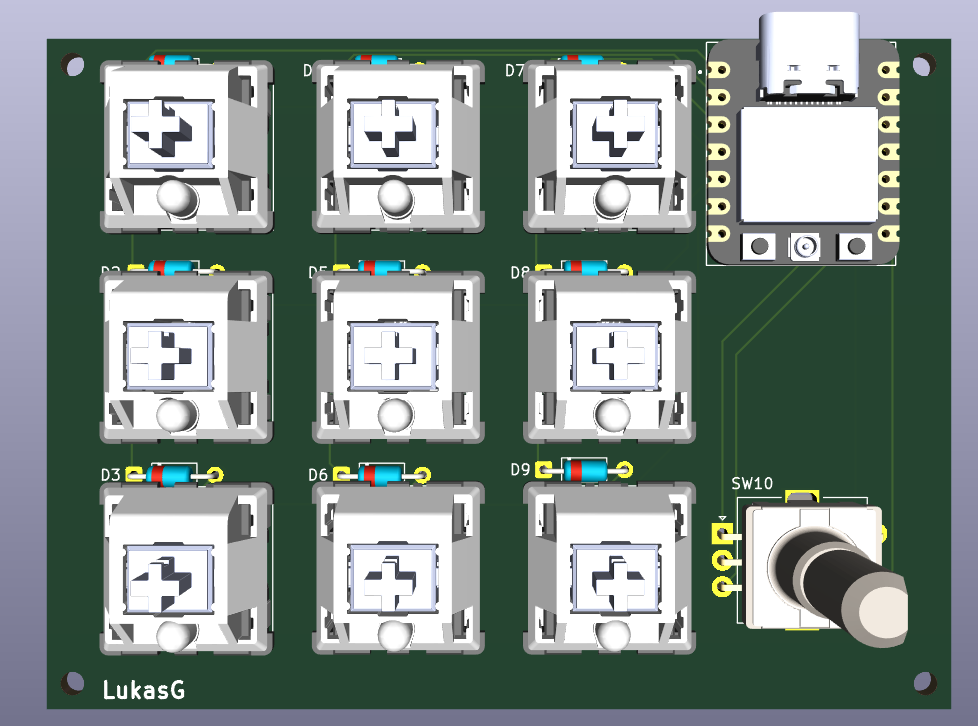
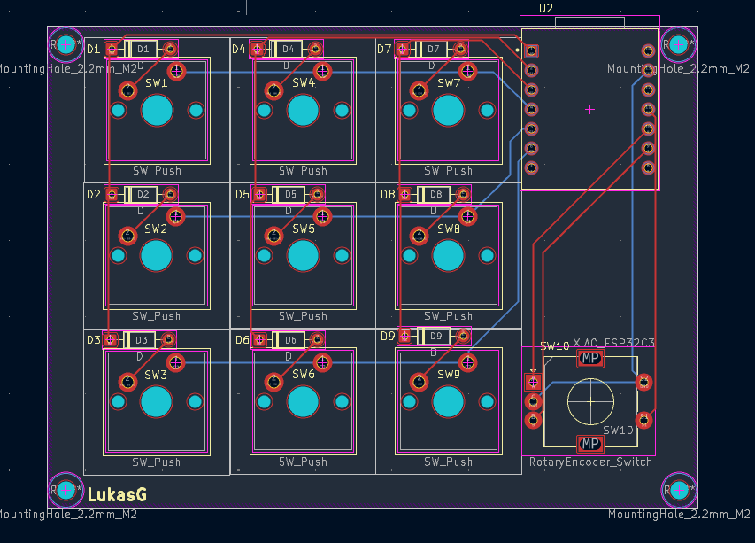

A custom Macro Pad with 9 switches and a rotary encoder with buttonfunktion all controlled by an esp32 USB-C. Built on a custom PCB. You can put shortcuts on any key to open for example an app or to skip at hilarious compination of keys with just one click. You have to order the pcb and the parts and solder it together on your on. At the end you need to upload the firmware(currently unavailable) and plug it via usb c into your computer.
Soon there will be a 3D modell for the casing and the source code

Pictures:

