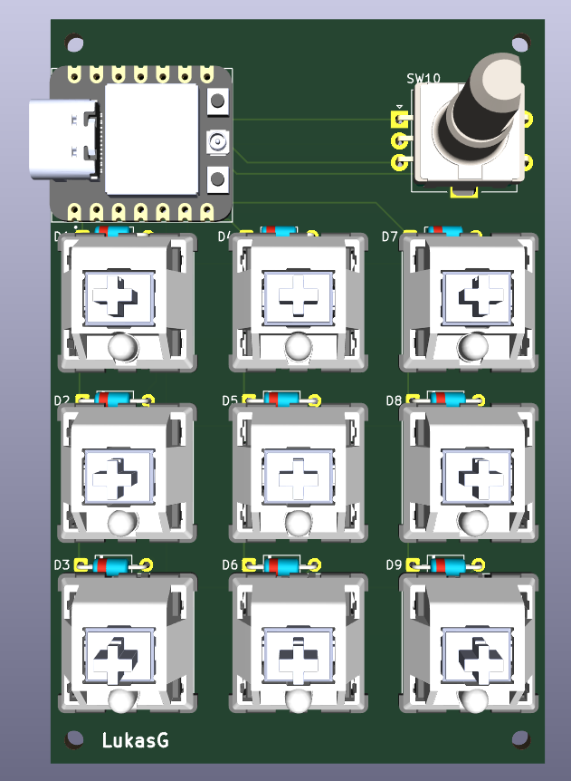
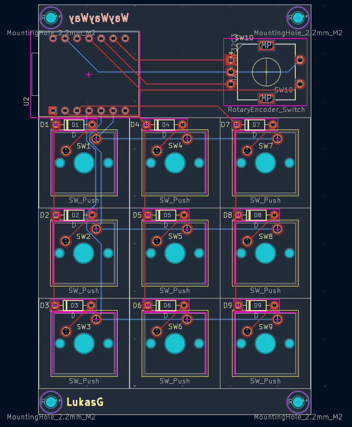

# Streamdeck MacroPad

A custom, USB-C macro pad built around a Seeed Studio XIAO ESP32-C3. The current design has nine push buttons and a rotary encoder with a push-button function, all mounted on a custom PCB.

The goal is to make a compact, customizable input device for shortcuts such as launching apps or controlling common actions. This repository contains the KiCad design files, a Gerber and drill-file archive, board images, and the current parts list. The board has not been manufactured yet, and firmware is not included at this stage.

## Design

I started with a larger idea: twelve keys and a small OLED screen. I found that the extra controls made the wiring and PCB design too complicated for this first version, so I reduced the scope to nine keys and a rotary encoder. That gave me a more manageable design while keeping the controls I wanted for a useful macro pad.

I designed the schematic and PCB in KiCad. I later changed the controller to the smaller XIAO ESP32-C3, which provides a USB-C connector, and added labels to the PCB. The latest design check reported zero errors. A friend is going to review the board before I treat it as ready to manufacture.

## Current status

- **PCB design:** laid out in KiCad; the latest design check reported zero errors.
- **Manufacturing:** not ordered yet. I am sorting out the parts and hoping to get funding for the order.
- **Gerbers:** included in [`PCB/MacroBoard_v2.zip`](PCB/MacroBoard_v2.zip) for anyone who wants to inspect or reproduce the board. Please review the design and manufacturing files before ordering.
- **Enclosure:** in progress and not finished yet.
- **Firmware:** not available yet.

The design is still awaiting a second review, so the current files should be considered a pre-manufacturing version rather than a tested, finished device.

## Board images

### 3D board view

### PCB layout

## Parts list

The current estimated parts list is available as [BOM.csv](BOM.csv) and [BOM.md](BOM.md). The prices in the list are estimates and may change with supplier, shipping, and taxes. Check component footprints and quantities against the KiCad files before ordering.

## Building from the files

1. Open [`PCB/MacroBoard.kicad_sch`](PCB/MacroBoard.kicad_sch) or [`PCB/MacroBoard.kicad_pcb`](PCB/MacroBoard.kicad_pcb) in KiCad, then inspect the schematic and board layout.
2. Review the design and BOM, and confirm that the footprints and parts match the parts you plan to buy.
3. Use the Gerber and drill files in [`PCB/MacroBoard_v2.zip`](PCB/MacroBoard_v2.zip) to review or order the PCB.
4. Source the components, assemble and solder the board, then add firmware when it is available.

This project has not been assembled or tested as a working device yet. The Gerber archive is provided for reuse, but anyone reproducing the board should verify the files and design first.

## What I learned

Learning KiCad and turning the idea into a routed PCB took time. I learned how the schematic, footprints, PCB layout, and manufacturing files fit together. I also learned to reduce the feature set when the wiring and layout became too complicated: dropping the OLED and three keys made the first version more achievable.

One problem I ran into was that the 3D model did not link to its footprint correctly. That made me realize that a footprint and its 3D model need to be configured and checked together. I am still working through the enclosure design, and the board is waiting for another review before I order parts.

## Repository files

- [`PCB/MacroBoard.kicad_sch`](PCB/MacroBoard.kicad_sch) — schematic
- [`PCB/MacroBoard.kicad_pcb`](PCB/MacroBoard.kicad_pcb) — PCB layout
- [`PCB/MacroBoardv3gerber.zip`](PCB/MacroBoardv3gerber.zip) — Gerber and drill files
- [`BOM.csv`](BOM.csv) — spreadsheet-friendly parts list
- [`BOM.md`](BOM.md) — formatted parts list
- [`JOURNAL.md`](JOURNAL.md) — project development journal
